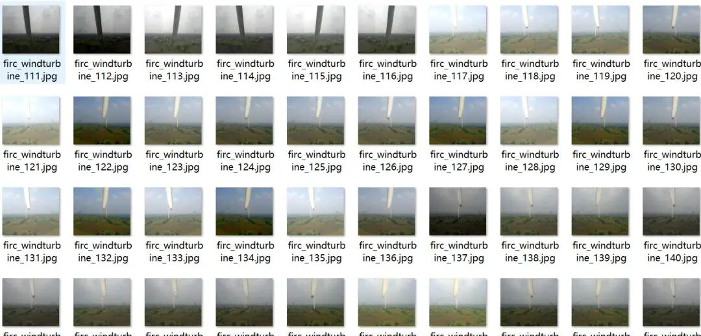
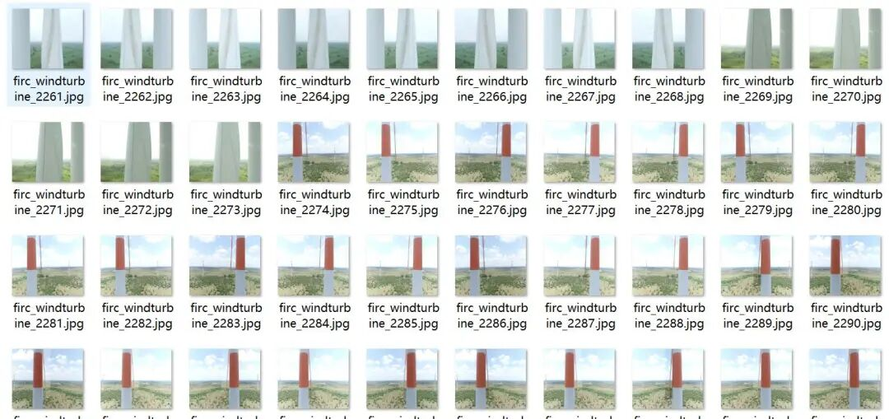
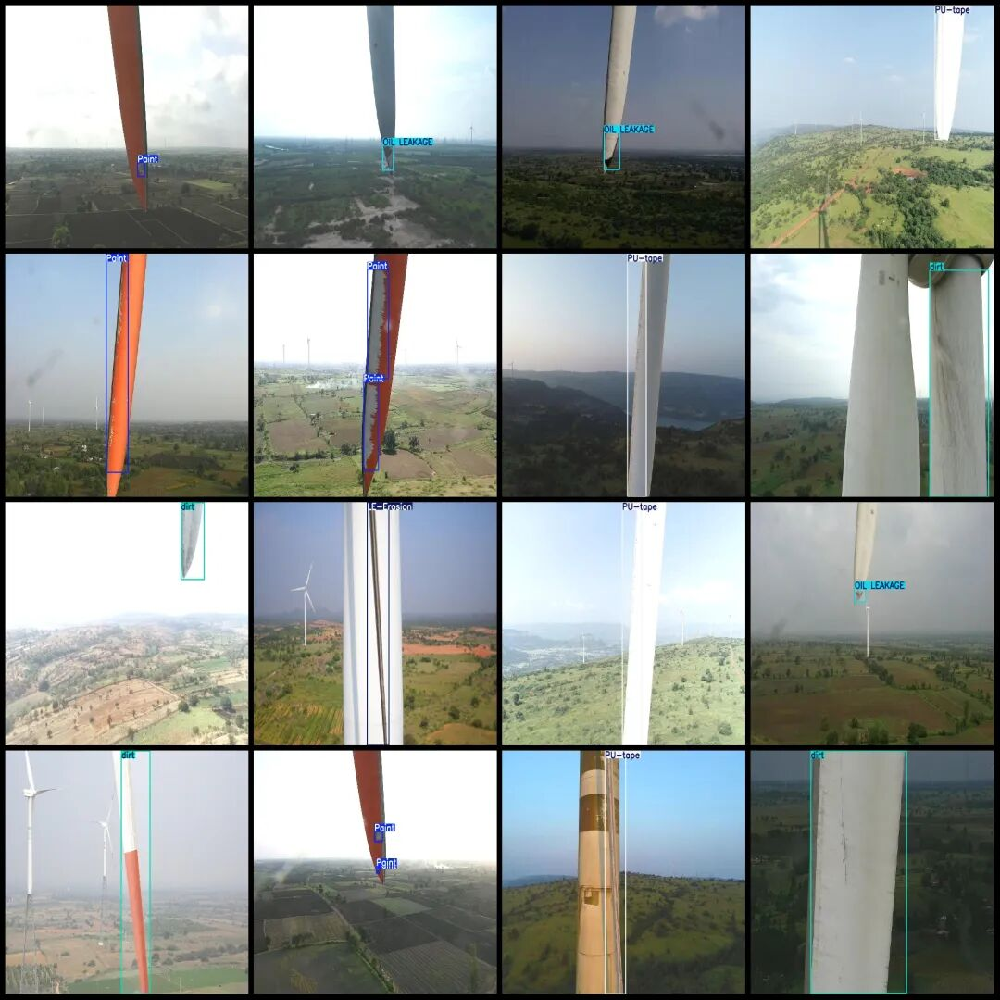
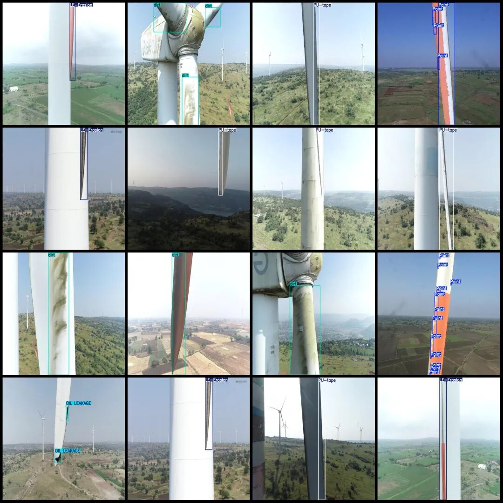

# UAV Perspective Wind Turbine Blades Damage, Corrosion, Oil Leakage, Dust Defects Detection Dataset in VOC+YOLO format with 3584 images across 5 categories

Dataset format: Pascal VOC format + YOLO format (txt file without split path, only contains jpg images and corresponding VOC format xml files and yolo format txt files)

Number of images (number of jpg files): 3584

Number of annotations (number of xml files): 3584

Number of annotations (number of txt files): 3584

Labeling category count: 5

Label category names (note that the order of yolo format categories does not correspond to this, but is based on the labels folder's classes.txt): ["LE-Erosion", "OIL LEAKAGE", "PU-tape", "Paint", "dirt"]

Number of boxes labeled in each category:

LE-Erosion (Local Erosion) Frame Count = 617

OIL LEAKAGE (Oil leakage) Frame count = 753

PU-tape (Polyurethane Tape) Frame Count = 700

Paint (Paint) Frame count = 2455

Dirt (dirt) Frames = 846

Total frame count: 5371

Image resolution: 1280x1080

Drone: DJI MAVIC 3

Collection height: 10-20m

Sampling angle: 0°

Using labelImg:

Annotation rules: Draw a rectangle around the category.

Important Notice: No

Special : This dataset does not guarantee the accuracy of the trained models or weight files.

Image Preview:

Annotation example:

## Payment

Here is a pay link on Stripe ( https://buy.stripe.com/3cs8yP7sY87d0vu9AB ). Please contact me lonlonago@foxmail.com after funding $89, and I will send you a complete data files , thank you!

